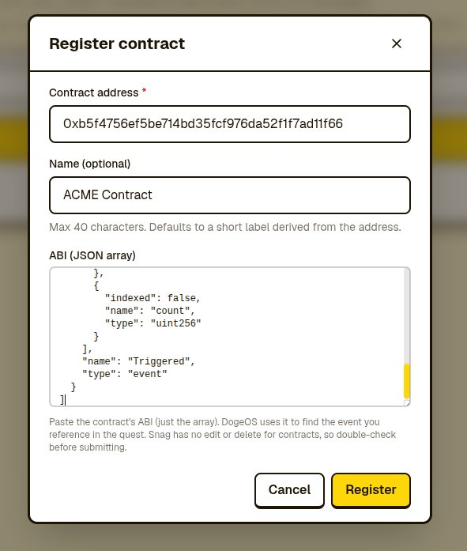

# DogeOS Partner Quest Demo

Integrate DogeOS quests using onchain smart contract events or actions verified by your backend. This guide covers both integrations, the local demo, the partner API, and the move from staging to production.

**Demo status:** this repository is a local/staging example. Its web app still pins `@dogeos/dogeos-sdk@3.3.0-beta.0` and `next@15.5.6`. Update and test supported dependencies before hosting it for users; the pinned Next.js version is affected by a [published security advisory](https://nextjs.org/blog/CVE-2025-66478). The example eligibility route also needs real user authentication and action validation before use with real rewards.

## Contents

- [Choose your integration](#choose-your-integration)
- [Start in staging](#start-in-staging)
- [Run the demo](#run-the-demo)
- [Smart Contract Event](#smart-contract-event)
- [External Rule](#external-rule)
- [Partner API reference](#partner-api-reference)
- [Going live](#going-live)
- [Troubleshooting](#troubleshooting)

Everything needed for the walkthrough is on this page. An optional [OpenAPI 3.1 document](docs/openapi.json) provides the endpoint contract for agents, API clients, and other tooling.

## Choose your integration

| Your user completes… | Use | Completion flow |
| --- | --- | --- |
| An onchain action that emits an event | **Smart Contract Event** | DogeOS detects the event. The quest's claim mode determines whether the user needs to click **Verify**. |
| An action validated by your backend | **External Rule** | Your backend calls `mark-eligible`; the user then clicks **Verify** in Questing. |

A partner API key is needed only for External Rule. Smart Contract Event does not call `mark-eligible`. You can integrate either type independently.

## Start in staging

| Service | URL |
| --- | --- |
| Partner Admin CMS | <https://thegrandheist-admin.vercel.app/> |
| Player app | <https://thegrandheist.vercel.app/> |
| Partner API base URL | `https://quest-api-staging.dogeos.com` |

Get partner access from your DogeOS contact. Use the same EVM wallet for the action and the Questing account. Staging has separate quest IDs, keys, configuration, and eligibility data; they do not automatically carry over to production.

Configure the Questing environment, blockchain network, and SDK project settings explicitly. Selecting a testnet does not automatically switch the other services to staging.

If integrating an existing application, go directly to [Smart Contract Event](#smart-contract-event) or [External Rule](#external-rule). To try this repository's example first, follow the local setup below.

## Run the demo

The repository contains a Foundry contract in `contracts/` and a Next.js dApp in `web/`. You need Node.js and npm; contract deployment also requires [Foundry](https://getfoundry.sh/), a development wallet, and testnet DOGE from the [faucet](https://faucet.testnet.dogeos.com).

Clone the repository, or extract the ZIP supplied by your DogeOS contact:

```bash
git clone https://github.com/DogeOS69/onchain-demo-partner.git
cd onchain-demo-partner
```

Repository access is required while the repository is private.

### Deploy the example contract — onchain path only

Skip this step when testing only External Rule. From the repository root:

```bash
cd contracts
forge install --root . --no-git foundry-rs/forge-std@v1.16.1
forge build
cp .env.example .env
```

Edit `contracts/.env` with your development wallet's `DEPLOYER_PRIVATE_KEY` and the testnet RPC below. Fund the wallet, keep the key private, then run:

```bash
./deploy.sh dogeos
cd ..
```

The script sends a deployment transaction and records the address in `contracts/deployments/6281971.json`. Each run deploys a new instance and overwrites that record; use your own deployment address.

| Testnet setting | Value |
| --- | --- |
| Chain ID | `6281971` |
| RPC | `https://rpc.testnet.dogeos.com/` |
| Explorer | <https://blockscout.testnet.dogeos.com> |
| Gas token | `DOGE` |

### Configure the web app

From the repository root:

```bash
cd web
cp .env.example .env.local
npm ci --legacy-peer-deps
```

The flag is needed by this demo's existing dependency lockfile. It reproduces the pinned versions; it does not update the SDK or fix outdated dependencies.

Edit `web/.env.local`:

| Variable | Used for | Value |
| --- | --- | --- |
| `NEXT_PUBLIC_EVENT_EMITTER_ADDRESS` | Onchain event card | Your deployed contract address. |
| `NEXT_PUBLIC_DOGEOS_CLIENT_ID` | SDK wallet integration | Registered client ID from the [developer console](https://console.dogeos.com/). Use the Sandbox ID for development and configure the application origin. |
| `NEXT_PUBLIC_WALLETCONNECT_PROJECT_ID` | WalletConnect | Your project ID, if using that connection method. |
| `DOGEOS_API_URL` | External Rule backend | `https://quest-api-staging.dogeos.com`. |
| `DOGEOS_PARTNER_API_KEY` | External Rule backend | Staging key created in the CMS. |
| `DOGEOS_EXTERNAL_QUEST_ID` | External Rule backend | UUID of your staging External Rule quest. |

Create the quest using the relevant section below. The [environment template](web/.env.example) contains the remaining public chain settings. The [current SDK guide](https://docs.dogeos.com/en/sdk) requires a registered client ID; do not rely on older beta behavior with an empty ID. `NEXT_PUBLIC_` values are exposed to the browser; never use that prefix for a partner key. Restart Next.js after changing environment values.

Start the local app from `web/`:

```bash
npm run dev
```

Open <http://localhost:3000>, connect the same EVM wallet you use in Questing, and approve the network switch if prompted. Use only the card you configured. Create the onchain quest and configure tracking before clicking **Trigger event**.

The example [server route](web/app/api/partner-complete-quest/route.ts) simulates a completed partner action. It accepts the browser's wallet address without authenticating the user or validating a real task. Keep this simulation local or in controlled staging; production must perform those checks before signaling eligibility.

## Smart Contract Event

Use this quest type when the user's action emits an event from your smart contract. No partner API key is needed.

### 1. Register your contract

In the staging CMS, open **Contracts → Register contract**.

| Field | What to enter |
| --- | --- |
| Contract address | Your deployed address on the network agreed with DogeOS. |
| Name | An optional label, up to 40 characters. |
| ABI | The JSON ABI array, containing the event definitions. Do not paste the surrounding build artifact. |



The screenshot is illustrative; enter your own contract address. For this demo's [`EventEmitter`](contracts/src/EventEmitter.sol), the minimal event ABI is:

```json
[
  {
    "anonymous": false,
    "inputs": [
      { "indexed": true, "internalType": "address", "name": "user", "type": "address" },
      { "indexed": false, "internalType": "uint256", "name": "count", "type": "uint256" }
    ],
    "name": "Triggered",
    "type": "event"
  }
]
```

You can use the full ABI from your build output instead. Check it and the address before saving; the current registration screen does not offer contract editing or deletion.

### 2. Create the quest

Open **Quests → New Quest** and select **Smart Contract Event** (`smart_contract_event`) under the onchain category available in your CMS.

- **Contract:** select the contract you registered.
- **Event:** select `Triggered`. Its canonical signature is `Triggered(address,uint256)`.
- **Address mapping:** map the credited wallet to the appropriate event field. The demo puts the caller's address in `user`.
- **Reward, frequency, claim mode, and availability:** choose the intended settings and make the quest available to your staging tester. A one-time quest is a simple first test.

Configure tracking before emitting the test event, and test during the active quest window. Do not rely on historical events being replayed.

### 3. Trigger the event and check completion

Click **Trigger event** in the demo, or perform the corresponding action in your own dApp. Approve the transaction and wait for its successful receipt on the correct network and contract.

Open the quest in staging Questing. If it uses manual verification, click **Verify**; if it uses automatic rewards, check for completion and the configured reward. Transaction confirmation, event detection, and quest completion are separate steps. Detection can take time, so verification may remain pending while processing; there is no fixed delay promised by this guide.

## External Rule

Use this quest type when your backend verifies an action on your platform. Eligibility is signaled server-side; the user then completes verification in Questing.

### 1. Generate a partner key

In the staging CMS, open **API Keys → Generate new key**. The raw key is shown once. Save it in your backend's secret store and send it as `X-Partner-API-Key`. If you lose it, revoke it and generate another. The key and quest must belong to the same partner and environment.

### 2. Create the quest

Open **Quests → New Quest → Other → External Rule** (`external_rule`). Configure the action description, destination URL, rewards, frequency, and availability. Save, then copy the quest UUID from the wiring dialog or quest list.

### 3. Signal eligibility from your backend

Authenticate the user, associate the correct EVM wallet with their account, and validate the action before calling DogeOS. The example wallet and quest UUID below are placeholders; replace both with your staging values. Load `DOGEOS_PARTNER_API_KEY` from your backend's secret store.

```bash
export DOGEOS_API_URL='https://quest-api-staging.dogeos.com'
export DOGEOS_EXTERNAL_QUEST_ID='11111111-1111-4111-8111-111111111111'

curl --fail-with-body --request POST \
  "${DOGEOS_API_URL}/v2/partner-api/quests/${DOGEOS_EXTERNAL_QUEST_ID}/mark-eligible" \
  --header "X-Partner-API-Key: ${DOGEOS_PARTNER_API_KEY:?Load your staging key first}" \
  --header 'Content-Type: application/json' \
  --data '{"walletAddress":"0x1111111111111111111111111111111111111111","metadata":{"actionId":"example-action-123"}}'
```

A successful response means eligibility was recorded. It does not mean the quest has completed or the reward was delivered.

### 4. Have the user click Verify

In staging Questing, the user opens the quest and clicks **Verify** with the same EVM wallet. When eligibility and the quest's other requirements are satisfied, the quest can complete. Otherwise, the user is told to finish the partner action and try Verify after the partner signals eligibility.

Test both outcomes: Verify before signaling with a fresh test wallet, then signal eligibility, Verify again, and confirm the expected reward. Also confirm that your backend rejects users who did not complete the action.

## Partner API reference

The optional [OpenAPI document](docs/openapi.json) describes the same DogeOS endpoint below. The demo's local `/api/partner-complete-quest` adapter has a different response envelope.

### Request

```text
POST /v2/partner-api/quests/{questId}/mark-eligible
```

| Parameter | Required | Description |
| --- | --- | --- |
| `questId` in path | Yes | UUID of an existing, non-deleted `external_rule` quest owned by your partner. |
| `X-Partner-API-Key` header | Yes | Raw partner key for the same environment. |
| `Content-Type` header | Yes | `application/json`. |
| `walletAddress` in JSON body | Yes | EVM address: lowercase `0x` prefix plus 40 hexadecimal characters. Surrounding whitespace is trimmed; storage and response addresses are lowercased. |
| `metadata` in JSON body | No | Audit context; use a JSON object with information such as your action ID or score. Do not send secrets. Omitted or `null` metadata becomes `{}`. |

Example body:

```json
{
  "walletAddress": "0x1111111111111111111111111111111111111111",
  "metadata": { "actionId": "example-action-123", "score": 100 }
}
```

### Success — HTTP 200

```json
{
  "data": {
    "marked": true,
    "questId": "11111111-1111-4111-8111-111111111111",
    "walletAddress": "0x1111111111111111111111111111111111111111"
  },
  "status": 200
}
```

### Errors

The following API validation failures return **HTTP 422**, including missing or invalid keys. Their `message` begins with `Validation error: `.

| Message after the prefix | Correction |
| --- | --- |
| `Missing X-Partner-API-Key header` | Add a non-empty key header. |
| `Invalid or revoked API key` | Use an active key from this environment. |
| `walletAddress must be a 0x-prefixed 40-character hex string` | Supply the player's EVM address. |
| `Quest {id} not found` | Check the UUID and environment; the quest must exist and not be deleted. |
| `This quest is not owned by any partner` | Confirm partner ownership with DogeOS. |
| `This API key does not have access to that quest` | Use the key for the partner that owns this quest. |
| `Quest type '{type}' does not support partner-marked eligibility. Only external_rule quests use this flow.` | Use an External Rule quest. |

Example error:

```json
{
  "message": "Validation error: Missing X-Partner-API-Key header",
  "status": 422,
  "code": null,
  "retryable": null,
  "recommendedAction": null,
  "source": null
}
```

Malformed JSON or an invalid quest UUID can return `400`; missing/wrong body field types can return `422`; a missing or unsupported JSON content type can return `415`. These responses, and infrastructure errors, may be plain text. Check the HTTP status and content type before parsing the body.

### Retries and recurring quests

A repeated signal for the same quest and normalized wallet updates the existing eligibility record. It refreshes the timestamp and replaces metadata; omitting metadata on a retry replaces the previous value with `{}`. Retry transient network/server failures with bounded backoff and the same payload. Correct validation errors before retrying.

Eligibility remains available after verification and does not automatically expire. A repeated signal is not a separate reward claim. For daily, weekly, or other recurring actions, agree the intended eligibility policy with DogeOS before launch; do not assume that one signal proves a new action in each period. Coordinate eligibility corrections with DogeOS.

## Going live

After the complete flow works in staging, contact your DogeOS representative with your staging quest IDs and intended launch date.

| Setting | Production value |
| --- | --- |
| Player app | <https://quest.dogeos.com/> |
| Partner API base URL | `https://quest-api.dogeos.com` |
| Quest ID | Production UUID confirmed with DogeOS. |
| External Rule key | Key generated for your partner in production. |
| Onchain tracking | Network, contract address, ABI, event, and wallet mapping confirmed with DogeOS. |

1. Confirm production ownership, rewards, claim mode, frequency, availability dates, and publication status. Staging quests and eligibility are not automatically copied.
2. For External Rule, change the API URL, quest UUID, and key together. Keep the key server-side and validate the user and action before signaling.
3. For Smart Contract Event, activate tracking before the test action. Confirm the production network rather than reusing testnet settings by assumption.
4. Update and test the demo's outdated dependencies before hosting it. Review the [SDK documentation](https://docs.dogeos.com/en/sdk) for supported integration behavior and confirm the client ID and application origin.
5. Run an agreed production test: perform the action, Verify if required, then confirm completion and reward in Questing.
6. Confirm with DogeOS that the quest is published and available before announcing it.

## Troubleshooting

| Symptom | Check |
| --- | --- |
| `forge: command not found` or missing `forge-std/Script.sol` | Install Foundry, then run the dependency setup from `contracts/`. |
| Wrong network or transaction rejected | Check the network, wallet approval, deployed address, and testnet DOGE balance. |
| Event picker is empty | Select a registered contract whose ABI contains the event. |
| Event name is ambiguous | Use an unambiguous event name; overloaded names are not supported by the current integration. |
| Transaction succeeded but the quest did not complete | Check the contract/event, wallet mapping, active quest window, and that tracking existed before the event. |
| “Demo partner backend isn't configured” | Set all three private `DOGEOS_*` variables and restart Next.js. |
| “DogeOS rejected the mark-eligible call” | Inspect the local route's `upstreamStatus` and `upstreamBody`, then check the API errors above. |
| Quest remains pending | Send your DogeOS contact the quest ID, EVM wallet, timestamp, and transaction hash or internal action ID. Do not send keys. |

MIT.
