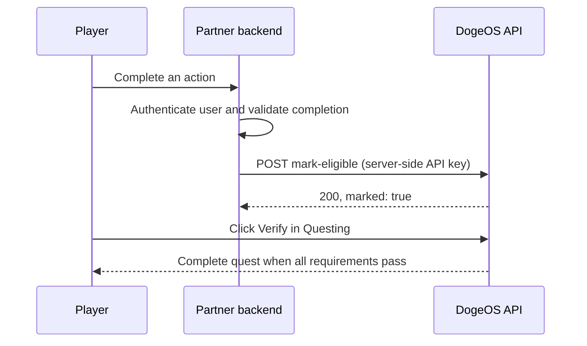
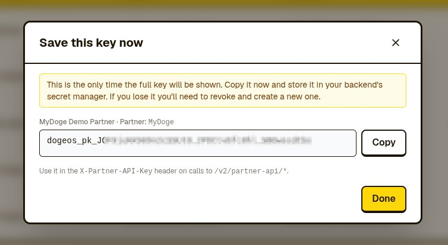

# External Rule quests

[Documentation home](../README.md) · [API reference](api-reference.md) · [Run the demo](run-demo.md) · [Going live](going-live.md)

Use an External Rule when your backend can verify that a user completed an action on your platform. Your backend signals eligibility to DogeOS; the user then clicks **Verify** in Questing to complete the quest.



## Before you start

Get access to the [staging Partner Admin CMS](https://thegrandheist-admin.vercel.app/) and identify the user's EVM wallet. Use the wallet associated with their Questing account, not a Dogecoin address or an unrelated deposit address.

## 1. Generate a partner API key

In the CMS, open **API Keys → Generate new key**. Save the raw key when it appears; it is shown only once.



Store the key in your backend's secret manager or server environment. Send it as `X-Partner-API-Key`. Never put it in browser code, a `NEXT_PUBLIC_` variable, a mobile bundle, or a committed file. If you lose the key, revoke it and generate a replacement.

The key and the quest must belong to the same partner and environment.

## 2. Create the quest

Open **Quests → New Quest → Other → External Rule** (`external_rule`). Configure the action description, destination URL, rewards, frequency, and availability.

Save the quest and copy its UUID from the wiring dialog or quest list. Make the quest available to your staging tester and use this UUID in your backend configuration.

## 3. Signal eligibility from your backend

After authenticating the user and verifying the required action, call:

```text
POST https://quest-api-staging.dogeos.com/v2/partner-api/quests/{QUEST_ID}/mark-eligible
```

Send these headers:

```text
X-Partner-API-Key: <your staging partner key>
Content-Type: application/json
```

Example body:

```json
{
  "walletAddress": "0x22a4839d6d0342283d42a0e973e3183fc14e4637",
  "metadata": {
    "score": 100,
    "internalUserId": "user_abc123"
  }
}
```

`metadata` is optional. Use a JSON object for audit context such as an internal action ID or score. Send only information needed to understand the eligibility signal; do not include secrets. The backend currently accepts any JSON value, but an object is the recommended integration format.

Example from a backend shell, with `DOGEOS_PARTNER_API_KEY` already loaded from your secret store:

```bash
export DOGEOS_API_URL='https://quest-api-staging.dogeos.com'
export DOGEOS_EXTERNAL_QUEST_ID='013f60a4-3a6e-4bb1-888b-435a845534a8' # replace with your quest UUID

curl --fail-with-body --request POST \
  "${DOGEOS_API_URL}/v2/partner-api/quests/${DOGEOS_EXTERNAL_QUEST_ID}/mark-eligible" \
  --header "X-Partner-API-Key: ${DOGEOS_PARTNER_API_KEY:?Load your staging key first}" \
  --header 'Content-Type: application/json' \
  --data '{"walletAddress":"0x22a4839d6d0342283d42a0e973e3183fc14e4637","metadata":{"source":"partner-backend"}}'
```

Success returns HTTP `200`:

```json
{
  "data": {
    "marked": true,
    "questId": "013f60a4-3a6e-4bb1-888b-435a845534a8",
    "walletAddress": "0x22a4839d6d0342283d42a0e973e3183fc14e4637"
  },
  "status": 200
}
```

This confirms **eligibility**, not quest completion or reward delivery. Repeating the same quest-and-wallet request updates the existing eligibility record; see [retry behavior](api-reference.md#retries-and-eligibility-lifetime).

## 4. Have the user click Verify

In [staging Questing](https://thegrandheist.vercel.app/), the user opens the quest and clicks **Verify** using the same EVM wallet you marked eligible.

If eligibility exists and the quest's other requirements pass, verification can complete the quest. Without an eligibility signal, the user is told to finish the action on the partner's platform and try Verify again after the partner signals DogeOS.

## Test both outcomes

1. With a fresh test wallet, click Verify before signaling eligibility. It should ask the user to complete the partner action.
2. Complete the action and send `mark-eligible`; confirm HTTP `200` and `data.marked: true`.
3. Click Verify again and confirm completion and the expected reward in Questing.
4. Confirm your backend rejects users who have not completed the action, rather than trusting a browser-supplied wallet address alone.

For endpoint errors, see the [API reference](api-reference.md). For this repository's server route and configuration, see [Run the demo](run-demo.md). Before launch, follow [Going live](going-live.md).
